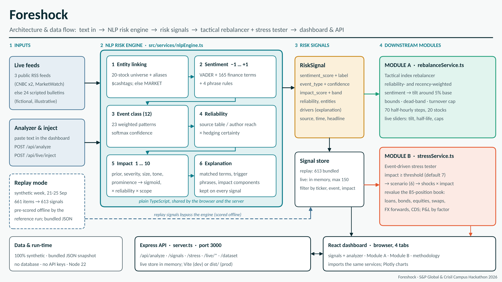
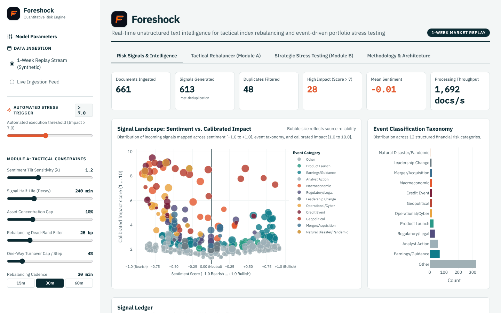
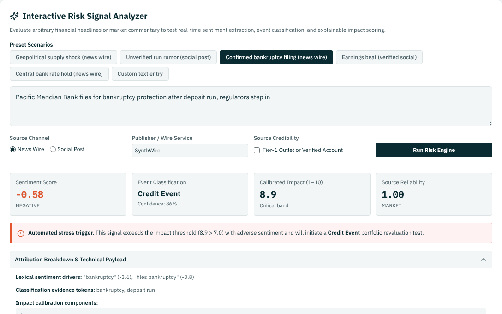
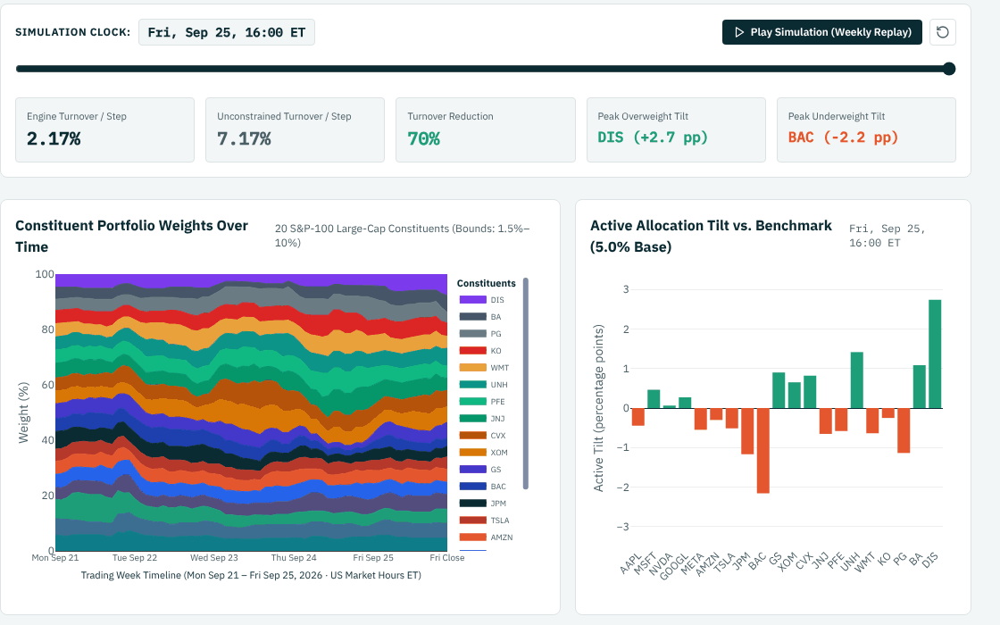
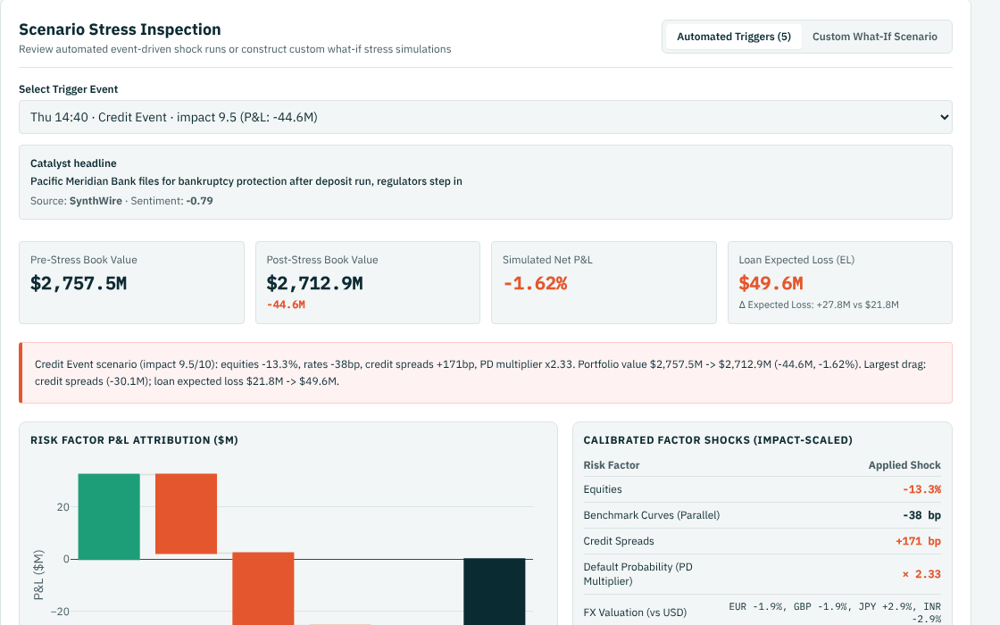

# Foreshock - S&P Global & Crisil Campus Hackathon

**Candidate Name:** [Your Full Name]  
**College Email ID:** bcs_2024039@iiitm.ac.in  
**College / Campus:** ABV-Indian Institute of Information Technology and Management (ABV-IIITM), Gwalior  
**Demo Video Link:** [YouTube unlisted link - add after recording]  
**Slide Deck Link (if hosted externally):** Not hosted externally. The deck is in this repo: [docs/presentation.pdf](docs/presentation.pdf)

> Foreshock reads financial news and social posts, scores each item for **sentiment** (-1 to +1), **event type** and **impact** (1-10), and feeds those signals into two downstream modules: **Module A**, a tactical index rebalancer, and **Module B**, an event-driven stress tester.

**Jump to:** [Quickstart](#4-quickstart--installation) | [Key results](#5-key-results--domain-impact) | [Limitations](#limitations) | [AI usage](#ai-usage-disclosure)

## 1. Project Overview / Problem Statement & Approach

**The problem.** Portfolio and risk teams face a constant stream of headlines, wire stories and social posts. Reading, judging and sizing each one by hand does not scale, and much of the stream is noise: duplicates, rumours from low-credibility accounts, and stories about companies the book does not hold. The case study asks for an AI/NLP risk engine that turns this text into structured, auditable signals (a sentiment score from -1 to +1, an event class and an impact score from 1 to 10) and then uses them in at least one downstream module. Foreshock builds both suggested modules on top of one engine.

**The approach.** The engine links each text to a 20-stock universe (or to the market as a whole), scores sentiment with VADER plus a finance-specific lexicon, classifies the event with weighted pattern rules (11 event classes plus "Other"), and turns event prior, wording severity, quoted magnitude, tone and entity prominence into an impact score, damped by source reliability and by hedged wording ("rumour", "unconfirmed"). Every signal carries its drivers (matched terms, trigger phrases, impact components), so a reviewer can see why a number came out as it did.

**What the signals drive.** *Module A, the tactical rebalancer,* converts reliability- and recency-weighted sentiment into small tilts around an equal-weight index and holds them in check with weight bounds, a dead-band and a turnover cap, so it does not trade on noise. *Module B, the stress tester,* is triggered when an event's impact crosses a threshold (default 7.0): it maps the event to one of six scenarios, scales the shocks by the impact score and revalues a synthetic 85-position book (loans, bonds, equities, swaps, FX forwards, CDS), attributing the loss to rates, credit spreads, default losses, equity and FX. Everything runs in one TypeScript app, a React dashboard on an Express API, with a replay mode over a synthetic trading week and a live mode.

## 2. Architecture & Tech Stack



**Data flow**

1. **Inputs.** *Replay mode* uses a bundled synthetic week (Mon 21 to Fri 25 Sep 2026) of 661 news items and social posts. *Live mode* polls three public RSS feeds (CNBC Markets, CNBC Finance, MarketWatch) about every 20 seconds and, when they return nothing new or cannot be reached, streams the next of 24 scripted illustrative bulletins. You can also paste any text into the analyzer or inject your own bulletin.
2. **NLP risk engine** (`src/services/nlpEngine.ts`). Entity linking, sentiment, event class, source reliability and certainty, then impact score and band, with the drivers attached. Output: one structured *risk signal* per item.
3. **Module A, tactical rebalancer** (`src/services/rebalanceService.ts`). Signals become per-stock evidence with recency decay, then tilts, then bounds, dead-band and turnover cap, giving 70 half-hourly weight vectors for the week.
4. **Module B, stress tester** (`src/services/stressService.ts`). A signal at or above the threshold selects a scenario; shocks are scaled by impact; the book is revalued from its sensitivities; P&L is attributed by asset class, sector and risk factor.
5. **Delivery.** The scoring engine, Module A and Module B are plain TypeScript modules. The browser imports them directly, so the analyzer and the sliders respond instantly. `server.ts` imports the engine, the stress tester and the live-feed store and exposes them as a REST API (Module A runs only in the browser; the API serves its stored weights). No database and no AI service is needed at run time.

**Tech stack**

| Layer | Technology (version tested) | Role |
|---|---|---|
| Dashboard | React 18.3.1, Vite 6.4.4, Tailwind CSS 4.3.3, lucide-react 0.460 | Four-tab UI |
| Charts | Plotly.js 2.35.2 (from the cdn.plot.ly CDN), IBM Plex fonts (Google Fonts) | Interactive charts, typography |
| API server | Node.js, Express 4.22.3, cors | REST API and static hosting on port 3000; Vite in middleware mode (dev) or `dist/` (production) |
| NLP | `vader-sentiment` 1.1.3 plus 165 finance-lexicon overrides, 4 phrase rules and 23 weighted event patterns | Sentiment, event type, impact |
| Language and tooling | TypeScript 5.9.3, tsx 4.23.15 | One language for UI, server and engine |
| Storage | None. A bundled JSON snapshot for replay; an in-memory live store capped at 150 signals | |

Versions are those npm resolved on 10-11 Oct 2026; the repo has no lockfile, so a later install may resolve newer versions within the ranges in `package.json`.

**Repository layout**

```text
iiitm-<your-name>-hackathon/
├── README.md
├── LICENSE                      MIT
├── package.json                 dependencies and scripts
├── server.ts                    entry point: Express API + static / Vite hosting
├── index.html, vite.config.ts, tsconfig.json
├── src/
│   ├── App.tsx, main.tsx, index.css
│   ├── components/              header, sidebar and the four tab views
│   ├── services/
│   │   ├── nlpEngine.ts         NLP risk engine (sentiment, event, impact)
│   │   ├── rebalanceService.ts  Module A
│   │   ├── stressService.ts     Module B
│   │   └── liveFeedService.ts   RSS parsing, scripted bulletins, live store
│   └── data/dataset.json        bundled replay dataset used by the app
├── data/                        synthetic data and reference outputs
├── public/                      logo and the diagram shown in the Methodology tab
└── docs/
    ├── presentation.pdf         7-slide deck (editable copy: presentation.pptx)
    ├── architecture.png         architecture diagram
    └── img/                     screenshots used below
```

## 3. Dataset Used

**Source and nature: entirely synthetic, generated for this exercise.** The repo contains no real, proprietary or client data, and nothing from S&P Global or Crisil was used. The company names and tickers are real S&P 100 constituents used only as labels; every news outlet, social handle and counterparty in the data is fictional.

| Data | Location | What it is |
|---|---|---|
| News and social text | `data/sample_news.jsonl` (223), `data/sample_social.jsonl` (438) | Synthetic items time-stamped 21-25 Sep 2026. News comes from six fictional outlets (`Synth...`, `news.example.invalid` URLs); posts come from 24 fictional handles (about 11% verified). Includes duplicates, hedged and unverified posts, and off-topic chatter to exercise reliability scoring and de-duplication. |
| Labelled evaluation set | `data/labeled_eval_set.csv` (96) | Short texts with gold sentiment, event type and impact, split 48 dev / 48 test. |
| Universe | `data/universe.csv` (20) | 20 stocks with equal 5% base weights, beta, prominence and name aliases for entity linking. |
| Synthetic book | `data/portfolio.csv` (85) | 36 loans, 22 bonds, 10 equities and 17 derivatives (swaps, FX forwards, CDS); market value $2,757.5M; stylised ratings, PD, LGD, durations, DV01 and CS01. |
| Scenarios | `data/scenarios.json` | Six event-to-shock templates (equities, rates, spreads, FX, PD multipliers). |
| Reference outputs | `data/output/` | 613 scored signals, 5 stress runs, rebalance log, weights history and evaluation report, produced offline by an earlier Python reference implementation of the same scoring approach. |
| Not used by the app | `data/prices_synthetic.csv`, `data/sample_transactions.csv` | A random-walk price file (independent of the news) and 2,400 synthetic bank transactions that shaped the synthetic book; kept for completeness. |

The app itself reads one file, `src/data/dataset.json`, a bundled snapshot of the files above (its signals, scenarios, universe, portfolio, stress runs and evaluation report are identical to the files in `data/`).

**Live mode** additionally reads the headlines (titles only) of public RSS feeds at run time; nothing from them is stored in the repo. The 24 scripted bulletins are invented illustrations: the outlet labels shown with them (for example "Reuters Financial") are display labels, not real reports.

**Assumptions**

- The index is an equal-weight basket of the 20 stocks; all activity falls on a 30-minute grid over five trading days (70 steps).
- The book, its ratings, PDs, LGDs and sensitivities are stylised; scenario shocks are templates scaled by the impact score, not calibrated to historical events or to any regulatory scenario.
- The labelled set is small and template-like, so it checks the engine for consistency; it is not a benchmark of real-world accuracy.
- No price or return series is used by Module A or Module B, so the project makes no back-tested P&L claim.

## 4. Quickstart & Installation

Runtime: Node.js 22.22.0 (npm 10.9.4) on Linux x64. Node 20+ should also work (Vite 6 and tsx declare support for it) but only 22.x was tested.

Step-by-step commands to set up the environment and run the app locally:

```bash
git clone https://github.com/<your-github-username>/iiitm-<your-name>-hackathon.git
cd iiitm-<your-name>-hackathon
npm install
npm run dev
```

Then open **http://localhost:3000**. The Risk Signals tab should show 661 documents, 613 signals and 28 high-impact signals for the replay week. `npm install` usually takes under a minute; the first page load takes a few seconds while Vite warms up.

**Other commands**

```bash
npm run lint                          # type-check (tsc --noEmit), passes with no output
npm run build                         # production build into dist/ (a chunk-size warning is expected)
NODE_ENV=production npm start         # serve the build; PowerShell: $env:NODE_ENV="production"; npm start
```

**Try the API** (the same paths also work without the `/api` prefix):

```bash
curl -s localhost:3000/api/health
curl -s -X POST localhost:3000/api/analyze -H 'Content-Type: application/json' \
  -d '{"text":"Pacific Meridian Bank files Chapter 11 bankruptcy after $38B deposit run, regulators intervene","source_name":"Financial Times"}'
curl -s -X POST localhost:3000/api/stress -H 'Content-Type: application/json' \
  -d '{"event_type":"Credit Event","impact_score":9.49}'
curl -s 'localhost:3000/api/signals?min_impact=8&limit=5'
```

| Endpoint | Purpose |
|---|---|
| `GET /api/health`, `GET /api/events` | Status and model version; the 12 event labels |
| `POST /api/analyze` | Score one text: `text`, optional `source_type`, `source_name`, `followers`, `verified` |
| `GET /api/signals` | Replay signals, filtered by `ticker`, `event_type`, `min_impact`, `source_type`, `limit`; add `mode=live` for the live store |
| `POST /api/stress` | Run Module B: `event_type`, `impact_score` (422 if the event has no scenario) |
| `GET /api/stress/triggers` | Stored replay stress runs at or above `threshold` (default 7) |
| `GET /api/live/signals`, `POST /api/live/sync`, `POST /api/live/stream`, `POST /api/live/inject` | Live feed: read, sync from RSS, stream the next scripted bulletin, inject your own text |
| `GET /api/portfolio/weights` | Last-step weights from the bundled reference run (the `summary` block holds fixed values) |
| `GET /api/dataset` | The full bundled dataset |

**Good to know**

- The browser needs internet access: Plotly is loaded from `cdn.plot.ly` and the fonts from Google Fonts. Without them the charts do not render.
- No API keys are needed. `.env.example` is a leftover; the code reads no environment variables except `NODE_ENV`.
- The port is fixed at 3000 in `server.ts` and the server listens on all interfaces with open CORS and no authentication. Use it for local demos only. If port 3000 is busy, stop the other process first.

## 5. Key Results & Domain Impact

### What the prototype demonstrates

<table>
<tr>
<td width="50%"><br><sub><b>Risk Signals &amp; Intelligence.</b> Replay-week KPIs, impact against sentiment, event mix and a filterable signal ledger.</sub></td>
<td width="50%"><br><sub><b>Analyzer.</b> Any text in; sentiment, event type, impact, reliability and the full driver breakdown out.</sub></td>
</tr>
<tr>
<td width="50%"><br><sub><b>Module A, tactical rebalancer.</b> Weights over 70 half-hourly steps, tilts against base, turnover; sliders for tilt strength, half-life, max weight, dead-band and turnover cap.</sub></td>
<td width="50%"><br><sub><b>Module B, stress testing.</b> Pick a triggered run or a live event; P&amp;L, breakdown by asset class and risk factor, change in loan expected loss.</sub></td>
</tr>
</table>

The fourth tab, *Methodology & Architecture*, shows the diagram and the assumptions. The sidebar switches between **Replay** and **Live** and sets the stress-trigger threshold.

### Measured results

The numbers in this section were produced by running this repo's own TypeScript services on the files in `data/` (Node 22.22.0, Linux x64), or are read from the stored reference outputs in `data/output/`. Protocol for the scoring table: news rows are scored as news from the outlet name `reuters`, social rows as verified posts with 100,000 followers; the engine's sentiment label, event type and impact score are compared with the `gold_*` columns, and plain VADER is the same `vader-sentiment` package used on its own.

**Replay funnel:** 661 documents, 613 signals (48 duplicates removed), 28 high-impact signals (impact score above 7), 5 stress runs.

**Scoring quality** on the 48-text held-out half of `data/labeled_eval_set.csv`:

| | Sentiment accuracy | Event accuracy | Event macro-F1 | Impact Spearman | Impact MAE |
|---|---|---|---|---|---|
| **TypeScript engine** (analyzer, API, live feed) | 0.604 | 0.646 | 0.679 | 0.589 | 1.40 |
| Reference run (scored the replay data) | 0.750 | 0.938 | 0.937 | 0.763 | 1.15 |
| Plain VADER / majority-class baseline | 0.646 / n.a. | n.a. / 0.083 | n.a. | n.a. | n.a. |

On all 96 labelled texts the TypeScript engine reaches 0.542 sentiment accuracy against 0.490 for plain VADER; on the held-out half alone it does *not* beat plain VADER (0.604 against 0.646). The labelled set is small and synthetic, so read these as consistency checks. On the 613 replay documents the TypeScript engine agrees with the reference run on event type for 90.7% of them, on sentiment label for 74.7%, and its impact scores correlate at about 0.8 (Spearman). Scoring speed is about 5,000-6,000 documents per second on one Node.js thread (analysis only, measured in a cloud container); the dashboard card that shows 1,692 docs/s is a fixed figure from the earlier reference run.

**Module B, event-driven stress tests.** The five runs triggered in the replay week, on the $2,757.5M synthetic book (the TypeScript `runStressScenario` reproduces each stored run to within $0.005M):

| Trigger (UTC) | Event class | Impact | P&L | % of book | Largest drag | Loan expected loss |
|---|---|---|---|---|---|---|
| Tue 22 Sep 18:01 | Macroeconomic | 8.69 | -$134.9M | -4.89% | Rates, -$102.5M | $21.8M to $32.9M |
| Wed 23 Sep 07:41 | Geopolitical | 9.07 | -$18.4M | -0.67% | Credit spreads, -$16.0M | $21.8M to $34.5M |
| Thu 24 Sep 14:40 | Credit Event | 9.49 | -$44.6M | -1.62% | Credit spreads, -$30.1M | $21.8M to $49.6M |
| Fri 25 Sep 10:10 | Natural Disaster/Pandemic | 8.63 | -$14.5M | -0.53% | Credit spreads, -$22.8M | $21.8M to $41.0M |
| Fri 25 Sep 15:32 | Operational/Cyber | 8.08 | -$7.5M | -0.27% | Equity, -$6.7M | $21.8M to $25.1M |

These runs were selected by the reference pipeline: impact above 7, adverse sentiment, a scenario for the event class and a 12-hour cool-down per class. In the Credit Event run, falling rates add $32.4M on the bond book while spreads (-$30.1M), default losses (-$27.8M) and equity (-$19.0M) subtract, and the expected loss on the loan book more than doubles.

**Module A, tactical rebalancer.** At the default sidebar settings (tilt strength 1.2, half-life 240 min, max weight 10%, dead-band 25 bp, turnover cap 4%, 30-minute cadence) the TypeScript rebalancer averages **2.17% turnover per step** over the 70 steps, with peak tilts of +2.7 pp (DIS) and -2.2 pp (BAC) against the 5% base weight. In the reference run that produced the bundled weights, the constrained engine averaged **1.90%** per step against **10.90%** for a naive rule (weights proportional to 1 plus the last interval's sentiment, fully traded every step): **82.6% less turnover** (`data/output/rebalance_log.csv`). The "unconstrained" series drawn in the app is a formula-based proxy rather than a simulated naive portfolio, so the reduction figure shown on screen is indicative only.

### Why it matters (domain impact)

- **Coverage at machine speed.** Scoring a document takes well under a millisecond, so every item in a feed can be screened and ranked rather than a sample.
- **Explainable and reproducible.** Rules plus a lexicon give the same score for the same text, and every score shows its components, which suits model-governance and challenge.
- **Cost-aware tactical tilts.** Module A shows how to act on sentiment without chasing headlines: bounded weights, a dead-band and a turnover cap cut trading by 82.6% against a naive rule in the reference run.
- **Faster first look at tail events.** Module B turns a headline into a first-cut loss estimate with drivers by rates, spreads, default losses, equity and FX, so a risk manager starts from numbers rather than a blank page.
- **Two horizons, one signal stream.** Company-specific news nudges weights; market-wide shocks go to the stress tester.

### Limitations

- **Rules and a lexicon, not a trained model.** Polarity can be wrong, especially for macro phrasing and slang: for example "inflation surges to a 40-year high" scores positive, and the "Earnings beat (verified social)" preset scores negative. Treat the output as triage, not as a view.
- **Two engines.** The replay signals were scored offline by a Python reference implementation that is not part of this repo; the TypeScript engine re-implements the same approach and is weaker on event classification (see the table above). Text analysed live can therefore score differently from similar replay items. The synthetic-data generator is also not included.
- **Synthetic data only.** Nothing here has been validated on real market data.
- **Simplified risk maths.** Module A has no return or transaction-cost simulation. Module B revalues from sensitivities (duration, convexity, DV01, CS01, PD x LGD), not from full pricing models or a regulatory framework.
- **Live mode is a demonstrator.** It needs internet access, reads three RSS feeds (headline text only), de-duplicates identical headlines only, does not corroborate across sources, keeps at most 150 signals in memory and loses them on restart. The GDELT, NewsAPI and CSV connectors mentioned in the Methodology tab are not implemented. Live stress triggers use impact at or above the threshold only (no adverse-tone filter or cool-down), and event classes without a dedicated scenario fall back to "Credit Event".
- **Housekeeping.** There is no automated test suite and no lockfile; `npm run lint` and `npm run build` are the checks that pass today. Foreshock was developed under the working name RiskPulse, and a few internal identifiers (npm package name, `model_version`, the server start-up log line) still use it.

**Possible next steps:** calibrate on real labelled data and add a transformer-based sentiment option; cross-source corroboration; a price-based back-test of Module A; a persistent store; unit tests and a lockfile.

## AI Usage Disclosure

AI assistance was used in this project, in line with the AI-usage rules of the hackathon guidelines. *[Review this section and complete it in your own words before submitting.]*

- Claude (Anthropic) was used to plan the project, to write the original Python scoring and synthetic-data pipeline whose outputs are bundled in `data/` and `src/data/dataset.json`, and to draft the documentation and slide deck in `docs/`.
- [Name the tool(s) used to build or port the TypeScript application and dashboard, and what each was used for.]
- [Describe what you reviewed, ran, changed or wrote yourself.]
- [Confirm that no confidential or client data was shared with any AI tool.]

## License

Released under the MIT License. See [LICENSE](LICENSE).
